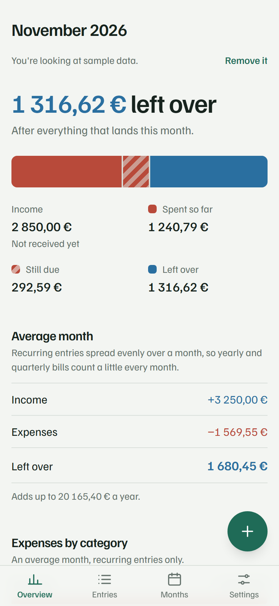
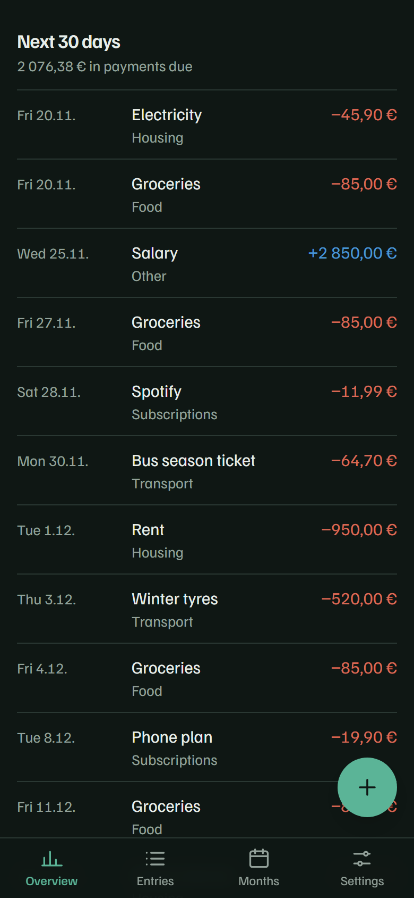
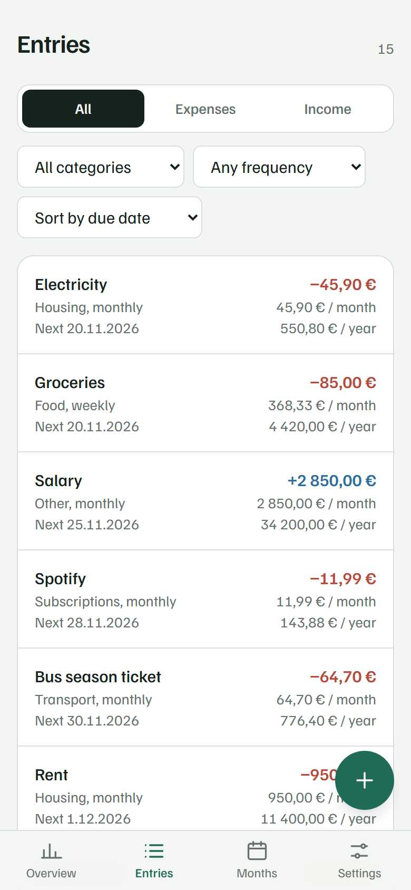

# Money left over

A phone-first app for recurring expenses and income: rent, subscriptions, insurance, salary. It shows what lands each month and how much is left over. It installs to the home screen, works offline and keeps all data on the device.

**[Open the live demo with sample data →](https://eerihyppanen.github.io/money-tracker/#/?sample)**

The demo loads example entries only in a browser that has no data of its own, and nothing ever leaves the device. To start empty, use [the plain link](https://eerihyppanen.github.io/money-tracker/).

  
  
  

## What it does

- **This month for real:** what has been paid, what is still due and what is left, from the charges that actually land this month.
- **Average month:** yearly and quarterly bills spread evenly, so a 480 € insurance counts as 40 € a month.
- **Next 30 days:** every payment coming up, in date order.
- **Months view:** step or swipe through past and future months, so you can see expensive months coming before they arrive.
- **Entries:** filter by type, category and frequency. Each entry shows its original, monthly and yearly amounts.
- **Your data stays yours:** JSON backup and restore, CSV export for Excel, a reminder when the last backup is old, and Undo after deleting.

## Decisions worth a look

- **Month-end dates keep their day.** A bill on the 31st lands on Feb 28 (or 29 in a leap year) and goes back to the 31st in March. Each entry stores the day it was meant to land on (`anchorDay`) instead of carrying the clamped date forward. See [`src/domain/dates.ts`](src/domain/dates.ts) and [`src/domain/schedule.ts`](src/domain/schedule.ts).
- **Money in integer cents, dates as `YYYY-MM-DD` text.** This avoids floating-point rounding and time-zone shifts. Only the display uses `Intl`, with Finnish formatting (`1 234,50 €`, `18.11.2026`).
- **Pure domain logic, with "today" passed in.** Nothing in `src/domain/` reads the clock or touches React or storage, so every rule is easy to test. Due dates that have passed move forward when the app opens or comes back to the foreground.
- **Storage behind an interface.** The UI talks to a `Repository`. The only implementation today is IndexedDB through Dexie, and the interface is shaped so a synced backend (e.g. Supabase) can replace it without touching the screens.
- **Offline and installable.** A service worker caches the whole app (about 130 kB compressed), and the app asks the browser for persistent storage so the data isn't cleared to free up space.
- **Accessible and colour-blind safe.** The expense and income colours were checked to stay distinguishable with colour blindness in both light and dark mode. Amounts never rely on colour alone (they carry a +/− sign or a label), and controls have labels and large touch targets.
- **Careful with your data.** Restoring a backup validates every field and shows what will be replaced before it does. The CSV export blocks spreadsheet formulas in entry names (`=HYPERLINK(…)` and the like), so a shared file can't run anything.

## Tested

Over 100 automated tests with Vitest:

- **Domain rules:** month ends, leap years, end dates, weekly months with four or five payments, rounding, backups, and the CSV formula guard.
- **Click-through tests:** the whole app runs in a simulated browser with an in-memory database, and the tests add, edit, delete, undo, swipe between months and load sample data the way a person would.

GitHub Actions runs every test before each deploy to GitHub Pages.

## Tech

React 19 · TypeScript · Vite · Tailwind CSS v4 · Dexie (IndexedDB) · vite-plugin-pwa (Workbox) · React Router · Vitest + Testing Library · GitHub Actions + Pages

Built with Claude Code, an AI coding assistant, as a pair programmer.

## Run it locally

| Command | What it does |
| --- | --- |
| `npm install` | Install dependencies |
| `npm run dev` | Dev server at http://localhost:5173 (add `#/?sample` for sample data) |
| `npm test` | Run all tests |
| `npm run build` | Type-check and build to `dist/` |
| `npm run preview` | Serve the production build, service worker included |
| `npx pwa-assets-generator` | Regenerate the app icons from `public/logo.svg` |

## Project structure

- `src/domain/`: pure logic, all unit-tested.
  - `schedule.ts`: due dates, monthly equivalents, charges per month
  - `dates.ts`, `format.ts`: date maths and Finnish formatting
  - `entryForm.ts`, `listing.ts`: form conversion and list filtering
  - `backup.ts`: JSON backups, CSV export, the backup reminder rule
  - `sample.ts`: the demo entries, dated from today
- `src/data/`: the `Repository` interface, its Dexie implementation and the React data context.
- `src/ui/`: layout, pages and components.
- `src/test/`: the click-through tests.

## Ideas for later

- Sync between devices, which would also remove the need for manual backups
- Reminders before payments are due
- Price history, to show when a subscription got more expensive
- Marking payments as paid, for bills whose amount varies

## Install on a phone

- **Android (Chrome):** menu → *Add to Home screen* / *Install app*
- **iPhone (Safari):** Share → *Add to Home Screen*
